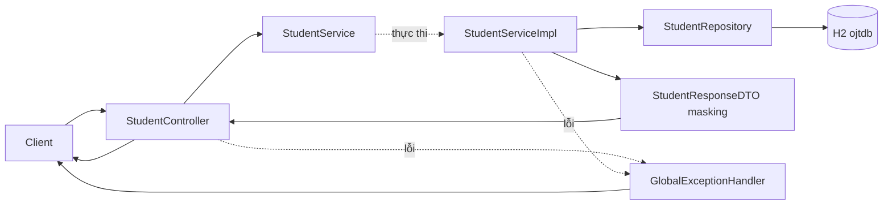

# Kiến trúc Student OJT Registration Service

**Học viên:** Nguyễn Vương Quốc Nam  
**Phạm vi:** Kiến trúc thiết lập ở Bước 3, triển khai nghiệp vụ ở Bước 4.

Source có lớp khởi động, các `package-info.java` mô tả package và các lớp
nghiệp vụ trong bảng bên dưới. Hai API đã được triển khai và nghiệm thu
local ở Bước 5 với 80 test tự động và 10 kịch bản cURL.

## Cách tổ chức

Tổ chức theo module `student`, bên trong phân lớp HTTP, DTO, service và
lưu trữ. Phần phản hồi lỗi tập trung nằm tại `shared.exception`.
Cấu trúc này giữ nghiệp vụ theo đề trong một module, dễ tìm source và
không cần thêm framework hoặc nhiều module Maven cho bài thực hành.

```text
src/main/java/com/r2s/masterclass/
├── StudentOjtApplication.java
├── student/
│   ├── controller/package-info.java
│   ├── dto/package-info.java
│   ├── service/
│   │   ├── package-info.java
│   │   └── impl/package-info.java
│   ├── entity/package-info.java
│   └── repository/package-info.java
└── shared/
    └── exception/package-info.java
```

Lớp khởi động ở `com.r2s.masterclass`, phía trên tất cả package nghiệp vụ,
để Spring Boot quét component, entity và repository trong cùng cây package.
Không cần thêm `@ComponentScan` hoặc `@EntityScan` để sửa lệch package.

## Danh mục lớp đã triển khai ở Bước 4

Các đường dẫn trong bảng tính từ `src/main/java/com/r2s/masterclass/`.

| File | Trách nhiệm |
| --- | --- |
| `student/controller/StudentController.java` | Hai endpoint, `@Valid`, HTTP 201/200; gọi interface service |
| `student/dto/StudentRequestDTO.java` | Java Record chứa dữ liệu đăng ký và Jakarta Validation |
| `student/dto/StudentResponseDTO.java` | Java Record chứa dữ liệu phản hồi; tự động masking SĐT và CCCD |
| `student/service/StudentService.java` | Interface `register` và `getById`, nhận/trả DTO |
| `student/service/impl/StudentServiceImpl.java` | Kiểm tra trùng, transaction, lưu/tra cứu và chuyển dữ liệu thành response |
| `student/entity/StudentEntity.java` | JPA Entity nội bộ, UUID, trường đăng ký và trạng thái mặc định |
| `student/entity/StudentStatus.java` | Enum lưu trữ với `PENDING_APPROVAL` |
| `student/repository/StudentRepository.java` | `JpaRepository<StudentEntity, UUID>`, kiểm tra Email/CCCD |
| `shared/exception/StudentAlreadyExistsException.java` | Biểu diễn lỗi trùng hồ sơ |
| `shared/exception/StudentNotFoundException.java` | Biểu diễn lỗi UUID không tồn tại |
| `shared/exception/ErrorResponse.java` | Record lỗi gồm timestamp, status, message và errors khi có lỗi validation |
| `shared/exception/GlobalExceptionHandler.java` | Ánh xạ exception thành JSON đúng API Contract |

Đây là cách phân lớp cho phạm vi bài tập. Không bổ sung generic base service,
base controller, mapping framework hoặc lớp trung gian không có nhiệm vụ cụ thể.

## Ranh giới giữa các lớp



- Controller dùng constructor injection với `StudentService`, không gọi
  repository và không import package entity.
- Service interface chỉ dùng `StudentRequestDTO`, `StudentResponseDTO` và
  `UUID`. HTTP status thuộc Controller và exception handler.
- Service implementation sử dụng Entity/Repository nội bộ. Khi tạo response,
  truyền các giá trị đơn vào DTO; DTO không nhận Entity làm tham số.
- Response dùng `String status`, được chuyển từ enum nội bộ bằng tên trạng
  thái. Client vẫn nhận đúng chuỗi `PENDING_APPROVAL`.
- Entity không phụ thuộc Controller hoặc DTO. Repository không chứa HTTP
  status hoặc quy tắc masking.
- Handler không đưa rejected value, SQL hoặc stacktrace vào JSON phản hồi.

Các ranh giới này được mô tả và kiểm tra khi viết code; cấu trúc package
tự nó không ngăn Java import sai tầng.

## Hợp đồng dữ liệu

### Request đăng ký

| Trường | Kiểu Java | Quy tắc |
| --- | --- | --- |
| `fullName` | `String` | `@NotBlank` |
| `email` | `String` | `@NotBlank`, `@Email` |
| `phone` | `String` | `@NotBlank`, `@Pattern` với `^0[35789][0-9]{8}$` |
| `nationalId` | `String` | `@NotBlank`, `@Pattern` với `^[0-9]{12}$` |
| `university` | `String` | Có trong DTO, không tự thêm ràng buộc bắt buộc |
| `major` | `String` | Có trong DTO, không tự thêm ràng buộc bắt buộc |

SĐT và CCCD dùng chuỗi để giữ số 0 ở đầu. Request DTO không có `id` và
`status`; hệ thống tự sinh hai giá trị này, không lấy từ payload đăng ký.
Không tự chuẩn hóa Email thành chữ thường hoặc thay đổi dữ liệu theo quy
tắc chưa có trong đề.

### Response thành công dùng chung cho POST và GET

| Trường | Kiểu Java | Nguồn |
| --- | --- | --- |
| `id` | `UUID` | Hệ thống sinh khi đăng ký |
| `fullName` | `String` | Hồ sơ đã lưu |
| `email` | `String` | Hồ sơ đã lưu |
| `maskedPhone` | `String` | Masking SĐT, ví dụ `090*****67` |
| `maskedNationalId` | `String` | Masking CCCD, ví dụ `079******789` |
| `university` | `String` | Hồ sơ đã lưu |
| `major` | `String` | Hồ sơ đã lưu |
| `status` | `String` | `PENDING_APPROVAL` khi đăng ký mới |

Masking nằm trong quá trình tạo `StudentResponseDTO`, trước khi Controller
trả response. Service không tự cắt bớt major hoặc status tùy endpoint.
Response không có trường `phone` hoặc `nationalId` chứa giá trị nguyên bản.

### Service và repository

Chữ ký service:

```java
StudentResponseDTO register(StudentRequestDTO request);
StudentResponseDTO getById(UUID id);
```

Repository kế thừa thao tác lưu và `findById` của JPA, bổ sung:

```java
boolean existsByEmail(String email);
boolean existsByNationalId(String nationalId);
```

## Luồng nghiệp vụ cho Bước 4

### Đăng ký

1. Controller nhận request Record và kích hoạt Jakarta Validation.
2. Service kiểm tra trùng Email và CCCD; trùng một trong hai trả lỗi 409.
3. Tạo Entity với UUID tự sinh và trạng thái `PENDING_APPROVAL`.
4. Repository lưu trong transaction. Unique constraint tại DB bảo vệ cả
   trường hợp hai request cùng vượt qua kiểm tra trùng ban đầu.
5. Tạo response Record có masking và trả HTTP 201.

Việc ghi dữ liệu cần được flush để lỗi unique được phát hiện; cả lỗi kiểm
tra trước và lỗi vi phạm đúng unique constraint đều phải ánh xạ về 409.
Không quy mọi lỗi ràng buộc dữ liệu thành lỗi trùng Email/CCCD.

### Tra cứu

1. Controller nhận UUID từ URL.
2. Service tra cứu bằng repository trong transaction chỉ đọc.
3. UUID hợp lệ nhưng không tồn tại trả 404 đúng thông báo của đề.
4. Nếu tồn tại, trả response Record đầy đủ và đã masking với HTTP 200.

UUID sai định dạng hoặc JSON không đọc được thuộc lỗi request 400, không
được biến thành lỗi không tìm thấy hồ sơ hoặc lộ thông tin nội bộ.

Mô hình hiện chỉ có một Entity, không có quan hệ JPA hoặc danh sách cần
lazy loading; không tự thêm quan hệ và truy vấn JOIN FETCH cho bài này.

## Hợp đồng HTTP và lỗi

| Trường hợp | HTTP | Body |
| --- | --- | --- |
| `POST /api/v1/students/register` thành công | 201 | `StudentResponseDTO` đủ 8 trường |
| `GET /api/v1/students/{id}` thành công | 200 | Cùng cấu trúc response POST |
| Validation thất bại | 400 | timestamp, status, message, errors object |
| Email hoặc CCCD trùng | 409 | timestamp, status, message |
| UUID hợp lệ không tồn tại | 404 | timestamp, status, message |

`ErrorResponse` dùng `Instant timestamp`, `int status`,
`String message`, `Map<String, String> errors`. Bỏ trường `errors` khỏi
JSON 409/404 khi không có lỗi validation; không thêm trường `error`,
`path` hoặc đổi `errors` thành `fieldErrors`.

Thông báo giữ nguyên theo đề:

- 400: `Dữ liệu đầu vào không hợp lệ`.
- 409: `Số CCCD hoặc Email đã tồn tại trên hệ thống OJT`.
- 404: `Không tìm thấy hồ sơ sinh viên với ID cung cấp`.
- SĐT: `Số điện thoại phải đủ 10 chữ số hợp lệ tại Việt Nam`.
- CCCD: `Số CCCD phải đúng 12 chữ số`.

## Phạm vi kiểm chứng

Bước 3 đã kiểm tra cấu trúc package, tính nhất quán tài liệu và build.
Bước 4 đã triển khai code theo hợp đồng này và chạy thử các luồng chính;
xem `STEP_4_VERIFICATION.md`. Bước 5 đã chạy bộ kiểm thử tự động,
giá trị biên, đồng thời và audit local; xem `STEP_5_VERIFICATION.md`.

## Căn cứ

- Đề bài Word: mục I, II và V về DTO, API Contract và dữ liệu;
  mục VI/VII về prompt và audit.
- Sáu quyết định người dùng đã chốt và `Dev_Prompt_Library.md`.
- [Spring Boot 3.5: vị trí lớp khởi động và package](https://docs.spring.io/spring-boot/3.5/reference/using/structuring-your-code.html).
- [Java 21: package declaration và package-info.java](https://docs.oracle.com/javase/specs/jls/se21/html/jls-7.html#jls-7.4.1).
- [Quyết định tổ chức module](decisions/001-student-module-layout.md).
